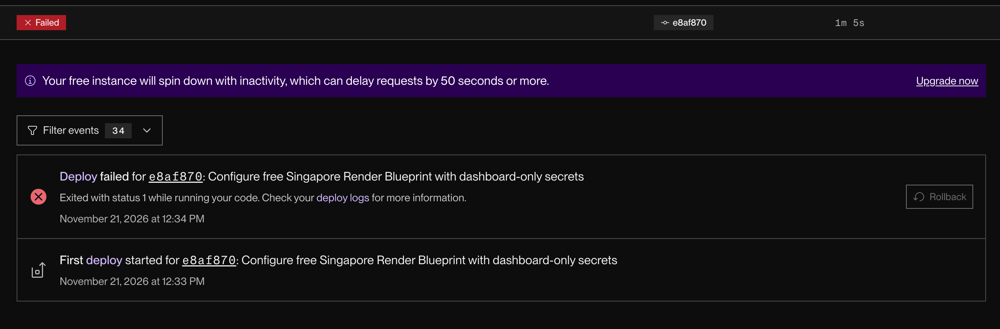

# BUG-014 — RecruitBoard Render deployment exits with status 1

**Status:** Open — deployment blocked; root cause not yet identified.  
**Severity:** Blocker for the public application.  
**Reported:** 21 November 2026, Asia/Kolkata.  
**Service:** [recruitboard-api](https://recruitboard-api.onrender.com) — deployment failed; not a working frontend link.  
**Repository/commit:** [DIVYAPRIYADHARSHINI-GIT/recruitboard, e8af870](https://github.com/DIVYAPRIYADHARSHINI-GIT/recruitboard/commit/e8af87048a9a4a9fd3c88cd28e6d0990aee8a9ad).

## Summary

The user-operated Render Blueprint deployment failed while starting the backend. The Events screenshot shows **Failed** and the exact message:

> Exited with status 1 while running your code. Check your deploy logs for more information.

The displayed duration is **1m 5s**. The UI shows the deployment starting November 21, 2026 at 12:33 PM and failing at 12:34 PM; the dashboard's timestamp zone was not independently confirmed.

## Expected result

The backend starts, completes its migrations/initialization, listens on Render's supplied port, and `/health` returns HTTP 200 with `{"status":"ok"}`. The frontend can then be deployed and its sign-in/role journeys verified.

## Actual result and impact

Render shows deployment failure with exit status 1. One approved health request timed out after 75.08 seconds; one separately approved bounded retry timed out after 15.01 seconds. Neither produced a successful response. The public hiring application is not available, and Netlify frontend deployment/live browser testing has not been completed.

## Environment and observed setup

The screenshot identifies a **Free**, **Python 3**, **Blueprint-managed** web service using main commit e8af870. The repository Blueprint requests Singapore, Python 3.11.15, root directory backend, one Uvicorn worker on `$PORT`, and health path `/health`. Actual dashboard environment values and the production database connection were deliberately not inspected or downloaded.

The user reported creating a separate Neon Free project in Singapore on its production branch. The Blueprint was deployed by the user. This is an observed failed deployment, not a fresh independent reproduction in another account.

## Screenshot

*Actual user-supplied Render Events screenshot, cropped locally to remove unrelated workspace/account navigation. This is not a fresh agent-captured dashboard image. Error text and status were not generated or edited.*

## Diagnostic evidence

- [Deployment event transcript](bugs/BUG-014-render-deployment-exit-1.md)
- [75-second health timeout](bugs/20261121-143128-449606-render-health-actual-service.txt)
- [Separately approved 15-second retry](bugs/20261121-143332-013042-render-health-approved-short-retry.txt)
- [Screenshot provenance/crop metadata](bugs/BUG-014-render-deployment-failed-user-supplied-detail.json)

## Cause, fix and next step

**Cause unknown; no fix is claimed.** The Events summary does not contain the exception or failed startup step. Exit status 1 alone does not establish a code defect, database issue, missing dependency, Render platform defect or Designer defect.

The next useful evidence is the actual startup traceback/error from Render's **deploy logs**, with connection strings, passwords and tokens redacted. Further health probing and blind redeployment were stopped. No paid upgrade, secret change, full live suite or load test was performed. The previously verified local checks remain separate from this failed production deployment.