# RecruitBoard — final delivery and verification report

**21 November 2026, Asia/Kolkata · Live verification completed at approximately 16:59.**

**Outcome: the complete RecruitBoard website and API are working on Vercel Hobby.** The database remains on the user's Neon Free project. The startup error shown by the user has been resolved without reading, downloading or changing the private database value.

| Link | Verified status |
|---|---|
| **[Open RecruitBoard](https://recruitboard-pi.vercel.app)** | Public live application; all three role journeys tested in real Chrome |
| [GitHub repository](https://github.com/DIVYAPRIYADHARSHINI-GIT/recruitboard) | Public; deployed application source commit **556bbe8** |
| [Deployment](https://recruitboard-pd5tkvoml-divya-6411.vercel.app) | Vercel reported Ready; canonical alias above was used for public tests |
| [Health endpoint](https://recruitboard-pi.vercel.app/health) | HTTP 200, `{"status":"ok"}`, verified through a real database query |
| [Historical Render bug report](BUG_REPORT.md) | Retained historical failure; Render is not used by the live application |

Use **Sign in → Try demo recruiter / interviewer / admin**. This is a shared fictional demo: **do not enter real candidate information**. No email is sent.

## 1. Project overview

RecruitBoard is an independently designed hiring-pipeline product with an original geometric logo, teal/paper visual identity and application code. It was built in the isolated recruitboard folder. No other local project was modified. ARCHITECTURE.md was written before implementation and extended before consequential hosting/security changes.

There are two separate projects in one repository. The frontend uses Vite, React and TypeScript and produces static assets. The backend uses Python, FastAPI, SQLAlchemy, Alembic and Argon2id. Local tests use isolated SQLite databases; the deployed application uses the existing Neon PostgreSQL database. Vercel Services routes the frontend and API through one domain, avoiding third-party cookies or a dependency on the failed Render service. The backend entrypoint applies only public configuration defaults before constructing the application; DATABASE_URL remains a dashboard secret.

Python is pinned to Vercel's supported **3.14 minor line**, verified locally on **3.14.6** and selected as 3.14 in the cloud build. Vercel controls the deployed patch release. The frontend declares Node 22.x and pins 22.22.0 locally; the cloud build logged Node/bootstrap npm engine warnings, although the static build succeeded. The exact Node patch used by every cloud build subprocess is not claimed verified.

Completed features include password and demo sign-in, jobs, per-job kanban with counts, drag-and-drop plus keyboard/touch Move to controls, rejection confirmation/reasons, candidate search/filter/sort/pagination, profiles, tags, notes, resume storage, stage/activity history, interviews, scorecards, offers, notifications, SQL hiring reports, protected CSV export, and admin user/role/settings/privacy actions. An interviewer can read only assigned candidates and can submit a scorecard only for their exact interview. Recruiters/admins cannot impersonate another interviewer. Server-side policies protect lists, counts, nested records and downloads, not just the interface.

The seed contains six fictional users, five jobs and forty candidates for the fictional Crescent Labs company, with interviews, feedback, rejections, offers and stage histories over the previous 90 days. It is explicitly enabled and refuses existing users or business records. Actual database-generated IDs are used instead of assuming sequences start at 1.

Resumes are stored in the database: **one PDF per candidate, at most 1 MB (1,048,576 bytes)**. Upload checks MIME, extension, signature/end marker and streamed size. Downloads use an attachment filename, nosniff and no-store. Every actual stage change records actor and timestamp; rejection requires an active reason. No email, analytics or external font/image requests are implemented.

### Hosting change and permissions

The original user request prohibited Vercel because of a reported usage limit. The user later explicitly replaced that instruction and approved the whole frontend/API deployment on **Divya (divya-6411), Hobby**, retaining Neon. Separate account/permission checkpoints were respected. Vercel CLI metadata confirmed Hobby and no reported block flag, but the billing-usage query could not guarantee remaining quota. The subsequent authorized uploads were accepted. No paid upgrade, payment details, new account to evade limits or unrelated project change was used.

The old Render deployment and Netlify plan are retained as history. Render was not deleted or altered to hide its failure, and Netlify was not deployed. Git commits for application fixes used the documented [skip render] marker. The active application has no Render/Netlify runtime dependency. The private Neon address never needed to be copied onto this Mac.

### Resolution of the final startup error

After the user supplied the private database variable, the backend first lacked its expected public origin settings. A dedicated Vercel ASGI wrapper fixed configuration delivery. Startup then rejected a pooled Neon URL because the original migration design used a session-level advisory lock.

The final correction supports both pooled and direct Neon connections safely. Initialization begins one explicit transaction, acquires `pg_advisory_xact_lock`, and runs Alembic and seeding on the same connection with no intermediate commit. The outer transaction commits once, or rolls back and releases the lock on failure. Timeouts are transaction-local; psycopg automatic prepared statements are disabled. PostgreSQL-only production, Secure cookies and exact-origin CSRF checks remain enforced. This is an architectural fix, not merely removal of a protective guard.

Source commit **556bbe8** was deployed to Vercel. Public health returned 200 in **0.81 seconds**, and session bootstrap returned 200 with demo enabled. The one full live Chrome suite then passed. No private value was inspected or changed by the agent.

## 2. Testing and evidence

### Latest suite results

| Suite | Passed | Failed | Scope and qualification |
|---|---:|---:|---|
| Backend on local Python 3.14 | **115** | **0** | API roles, assignment isolation, sessions/CSRF, strict inputs, workflows/history, duplicates, resumes, scorecards, notifications, privacy, reports/CSV, migrations, shared rate limits, seed offsets, entrypoint defaults and transaction/rollback contracts |
| Frontend unit tests | **16** | **0** | Formatting, file validation, same-origin API credentials/CSRF and friendly errors |
| Local real-Chrome journeys | **66** | **0** | Three roles, browser actions, uploads/downloads, keyboard/drag moves, themes/mobile, cleanup; performed before the final pooling-only change |
| Current Vercel configuration checks | **8** | **0** | Two services, routes, entrypoint, bundle includes, versions, security headers, upload exclusions and schema constraints |
| **Full live Chrome suite — run once only** | **66** | **0** | Final deployed application and PostgreSQL, all three roles, Secure/HttpOnly same-origin session behavior, full workflow, reports, mobile, accessibility and cleanup |
| Earlier Netlify proxy configuration | 8 | 0 | Historical, superseded hosting path; not added to active totals |
| Earlier Render Blueprint configuration | 9 | 0 | Historical configuration/schema validation; did not prove its deployment succeeded |

The four current local/configuration suites account for **205 passing checks**; the single live suite adds **66 successful live checks**. Repeated historical passes are not added again. Both the local and live Chrome journeys include **18 axe WCAG A/AA page/modal audits** with zero violations and matching layout checks. Those audits are included in the 66, not separate extra tests. Automated coverage is not a full accessibility certification.

Chrome version was **157.0.8103.79**. The live run lasted approximately **51 seconds**, recorded **zero unexpected console/page errors**, and used the public canonical origin without a Vercel authentication bypass token. It verified the actual Secure/HttpOnly/host-only session cookie, absence from document.cookie, sign-in persistence, assigned-only reads and full recruiter/interviewer/admin actions.

The production static build completed: about **319.40 kB JavaScript (98.61 kB gzip)** and **60.72 kB CSS (11.99 kB gzip)**. TypeScript/build checks passed. Two upstream Python test-client deprecation warnings remain. The earlier dependency audits were clean after targeted upgrades; because later Python compatibility pins changed, that earlier clean scan is not represented as a fresh audit of every final dependency. No load test was performed.

### Exact live evidence and cleanup

- [Live named-check output](evidence/20261121-165850-515288-vercel-full-live-chrome-once.txt)
- [Live result JSON, browser version and cleanup records](evidence/2026-11-21T11-27-59-347Z-live-browser-results.json)
- [Successful public database-health check](evidence/20261121-165718-110695-vercel-pool-fix-public-health.txt)
- [Final backend regression result](evidence/20261121-165352-016212-pool-safe-startup-backend-regressions.txt)
- [Final deployed build output](evidence/20261121-165641-194816-vercel-pool-compatible-fix-deploy.txt)

The live suite created **candidate 41, TEST Journey 11-27-59**, and **candidate 42, TEST Unassigned 11-27-59**. **Both were permanently deleted** through the admin flow, with dependent records removed. The temporary scorecard-guidance change was restored. No persistent test user was created in production. Demo authentication sessions are transient and expire under the normal session policy. The built-in fictional company/users/candidates intentionally remain. Earlier local test candidates were also cleaned or existed only in isolated disposable SQLite fixtures.

The exclusive live-suite marker remains in evidence/live-suite-started.json. It was not removed or bypassed. This was the **only full live suite**. Earlier deployment checks were brief targeted health requests and bounded log queries.

### Historical failures were retained

Foundation attempts recorded one collection error, then one pass/nine fixture errors before ten passes. The first business suite recorded 84 passes/one failure before correction. Earlier local browser attempts stopped at the first failure with 1/1, 4/1, 12/1 and 34/1 pass/fail totals. The sequence-offset seed regression deliberately reproduced one failure before its fix. Vercel schema validation initially recorded seven passes/one failure before dialect correction. Actual command/dependency/deployment failures and their retries remain under their original filenames in bugs/.

External checks also remain visible: one placeholder Render hostname returned 404; two actual Render health requests timed out (75.08 and 15.01 seconds); the user's Render Events capture showed exit status 1. Three earlier Vercel startup checks returned 500 for missing Production database configuration, missing public settings and pooled-connection incompatibility. The final startup correction returned 200 and the live suite passed. A successful build status alone was never treated as functional proof.

### Actual live screenshots

All screenshots in this section were captured by real Chrome against **https://recruitboard-pi.vercel.app** during the single live run. They are not generated mockups. Some counts include the two TEST candidates because screenshots preceded cleanup.

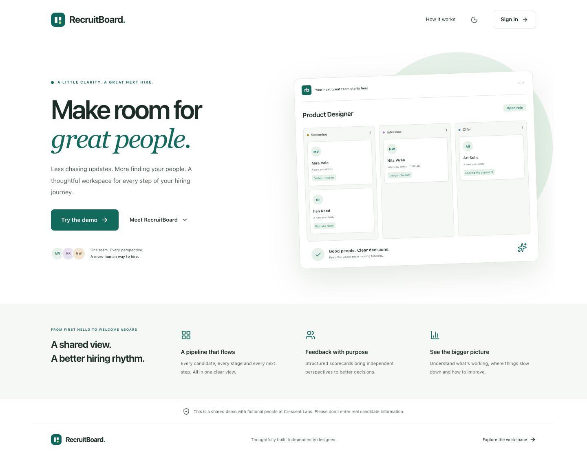
*Live home: RecruitBoard's original identity and introduction.*

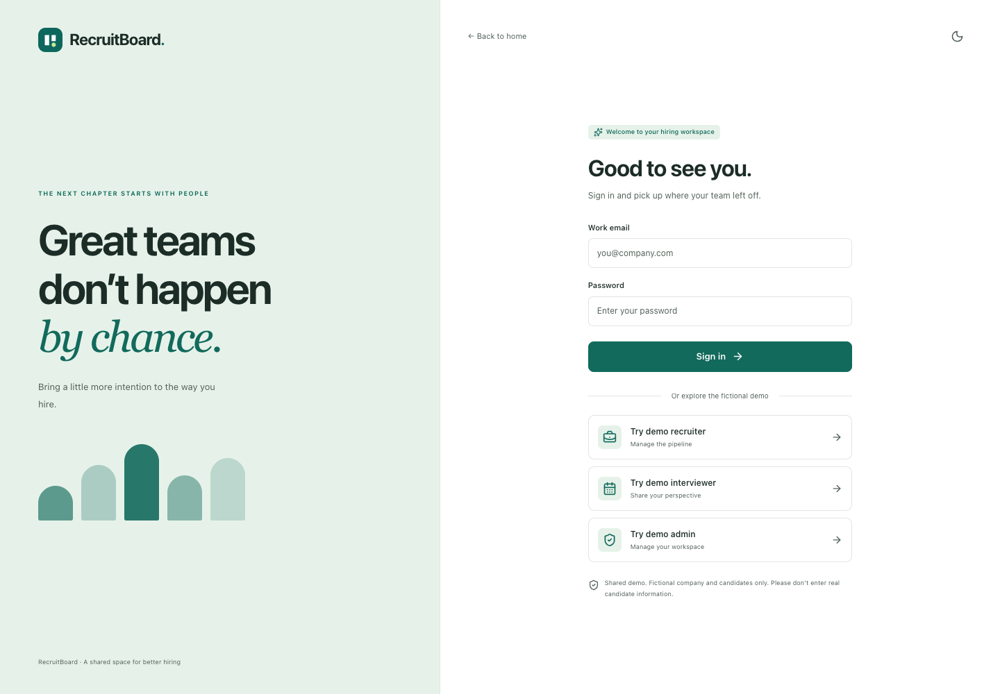
*Live sign-in: explicit demo-role options and fictional-data warning.*

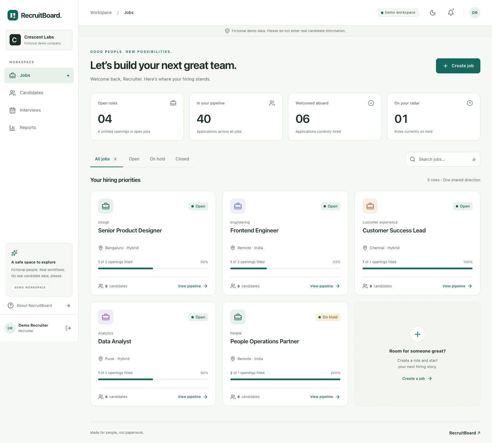
*Live jobs: five seeded roles, stage-independent position counts and job filters.*

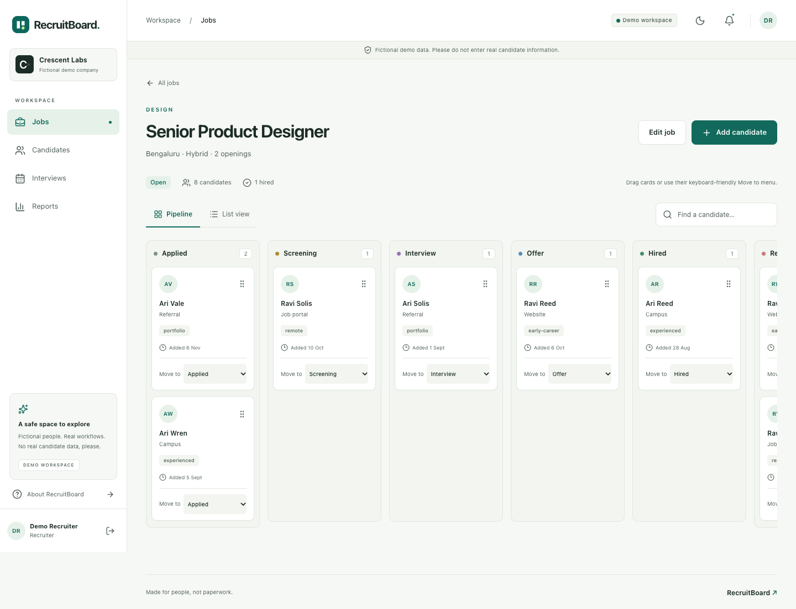
*Live kanban: six stages, column counts and accessible Move to controls.*

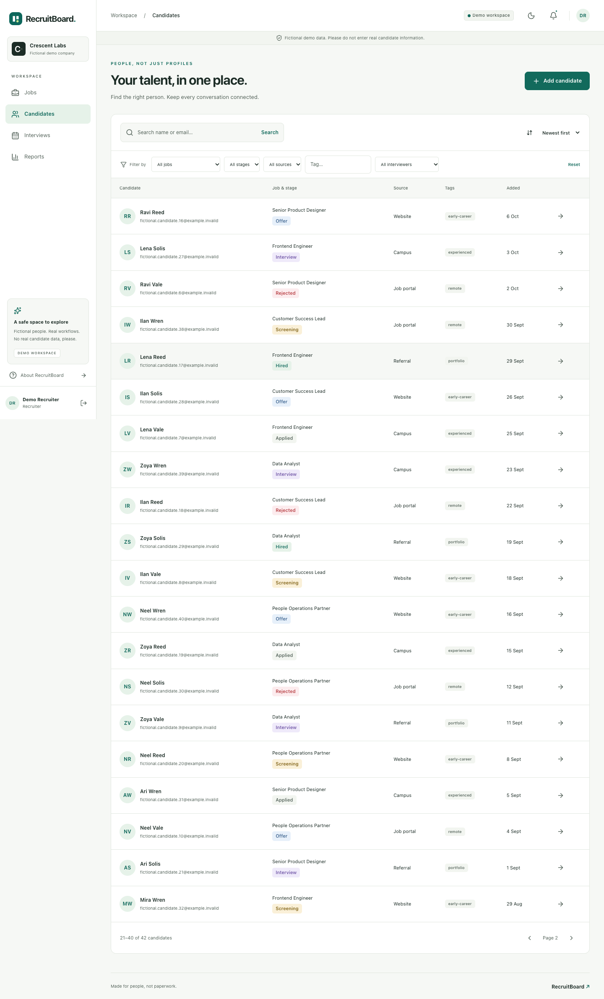
*Live candidates: server-backed search, combined filters, sorting and pagination.*

*Live profile: clearly named TEST candidate, shared notes, application and resume limit.*

*Live scorecard form: only the assigned interviewer can submit ratings and written evidence.*

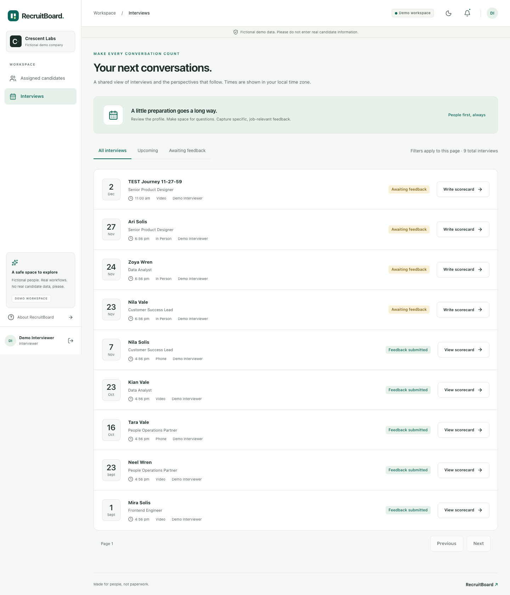
*Live interviews: assigned candidates, interview time/mode and feedback state.*

*Live light reports: PostgreSQL-derived funnel, hire time, sources, dwell, offers, rejections and activity.*

*Live dark reports: theme persistence and accessible chart/text treatment.*

*Live notifications: stage and scorecard updates without email.*

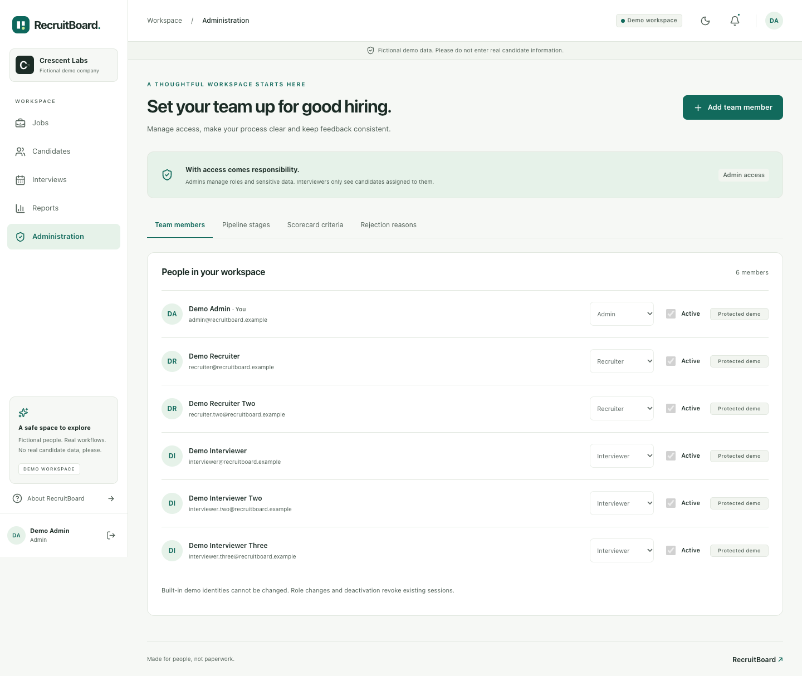
*Live admin: user roles, active state and protected demo identities.*

*Live stage settings: editable presentation with stable reporting keys.*

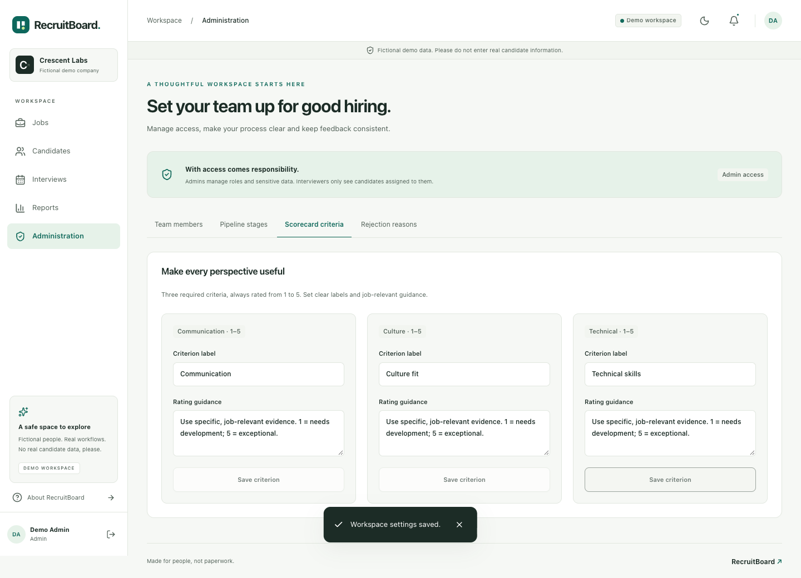
*Live scorecard criteria: the test's temporary guidance change was restored.*

*Live rejection reasons: required reasons and active/inactive configuration.*

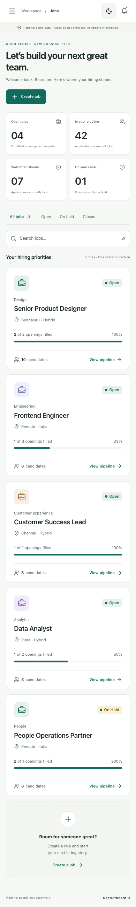
*390-pixel light-theme mobile jobs view, no document overflow.*

*390-pixel dark-theme mobile view, navigation tested.*

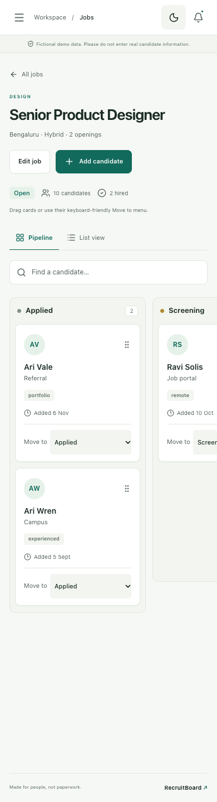
*The board scrolls horizontally within the page; touch/keyboard Move to remains available.*

## 3. Bugs and issues

### Backend implementation failures — fixed

**Validator helper collision:** the initial schema helper named email was shadowed by its field, causing collection to fail. Renaming it normalize_email fixed the error. The [collection diagnostic](bugs/20261121-102728-390446-stage1-backend.txt) remains.

**Missing pytest scratch parent:** an explicit project-local scratch path had no parent, causing nine fixture errors. Creating the parent fixed the harness; the [failed retry](bugs/20261121-102758-707581-stage1-backend-retry1.txt) remains.

**Duplicate scorecard autoflush:** a notification-recipient lookup flushed a duplicate scorecard before the conflict handler, causing an exception instead of 409. Request sessions now use explicit flush/commit boundaries. The [failed business run](bugs/20261121-103000-207733-stage2-backend.txt) is retained. It contained fictional TEST feedback in SQL parameters; later exceptions hide parameters and return/log only safe diagnostics. No real candidate or credential was involved.

**Seed ID assumptions, BUG-017:** hardcoded user/job/reason IDs failed when generated IDs did not begin at 1. A local offset-ID test reproduced the foreign-key failure. The seed now references inserted row IDs and refuses nonempty business data. [Original failure and fix](bugs/BUG-017-demo-seed-assumed-database-ids.md) remain. This was never falsely assigned as the proven cause of the old Render failure.

### Browser design/accessibility defects — fixed

The first home audit found low contrast in a small decorative avatar. Darkening its text fixed it. The next sign-in audit found muted text below contrast requirements on a tinted background; darkening the shared light-theme token fixed those nodes.

*Original local failed capture; the affected element was the third decorative avatar.*

*Original local failed capture; axe identified the aside paragraph and footer text.*

A candidate-form test could not match the exact Job accessible name because implicit label text included option content. Explicit concise labels corrected the control and journey.

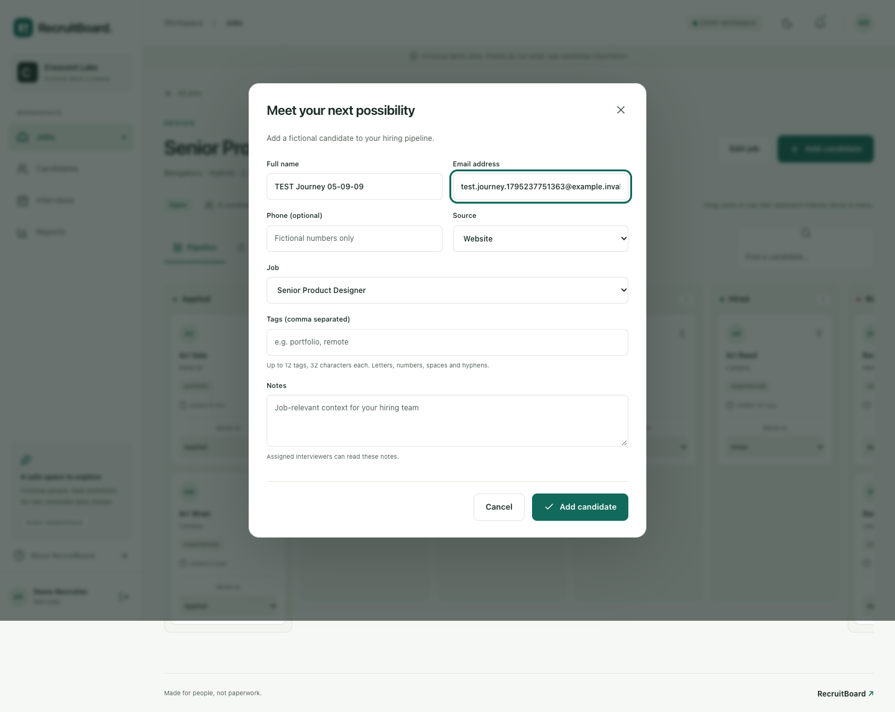
*Actual stopped local test before candidate submission.*

Visual screenshot review caught a vertically stacked search field: the shared label rule had overridden flex direction. Explicit row layout corrected search, sort and Move to labels.

*Original jobs capture with the incorrectly tall search field.*

The notifications audit rejected aria-label on a generic unread span. An appropriate role fixed its semantics.

*Actual failed local notification audit; the defect was semantic, not visible layout.*

### Deployment failures and their actual outcomes

**Historical Render failure, BUG-014:** the user's Events screenshot showed the first deployment exiting with status 1 after 1m 5s. Its actual traceback was never supplied, so its root cause remains unknown. This service is no longer in the active application path, and no fix or deletion of it is claimed. [Historical issue report](BUG_REPORT.md).

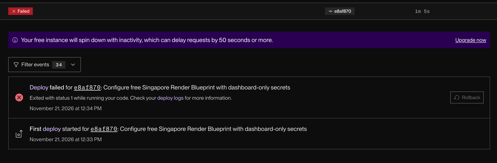
*User-supplied screenshot, privacy-cropped locally. Not a fresh agent dashboard capture. The original failure record was preserved after the hosting change.*

**Missing Vercel Production database variable, BUG-018:** the initial upload built successfully but returned 500. Redacted runtime logs identified the production PostgreSQL/Secure-cookie guard, and names-only metadata confirmed DATABASE_URL was absent. A conditional redeploy was stopped when a second preflight still found it absent. The user subsequently saved the secret correctly. No value was fetched, printed or stored. [Diagnostic history](bugs/BUG-018-vercel-production-database-config.md).

**Public-default delivery, BUG-019:** after the database variable existed, the backend still lacked the expected exact HTTPS origin. The top-level configuration declaration had not delivered the public defaults as intended in Services mode. A dedicated vercel_entry.py now applies only public defaults before importing app.main, preserving explicit overrides. Four new tests verified import order, overrides and startup. [Issue and fix](bugs/BUG-019-vercel-service-public-settings.md).

**Pooled Neon incompatibility, BUG-020 — resolved live:** startup then rejected the pooled URL because initialization used a session-level lock. The final design uses a transaction-level advisory lock spanning all migrations and seed work on one connection, with one commit/rollback, transaction-local timeout settings and compatible psycopg configuration. Six new regressions passed; the final cloud health and all live journeys then passed using the existing private connection setting. [Complete retained chronology](bugs/BUG-020-neon-pooled-url-startup-guard.md). The earlier direct-URL-only advice is superseded by this supported design; it was not hidden or silently rewritten as though no error occurred.

### Dependency, tool and builder errors — recorded, not hidden

- **Research contradictions:** an early search incorrectly said Netlify did not support Node 22. Primary build docs corrected it (BUG-001). A Blueprint summary mixed unofficial sources and oversimplified existing-service adoption; direct docs established a duplicate-resource risk (BUG-012). Primary sources, not broad search prose, drove the implementation.
- **Dependency advisories:** initial router/runtime and Python dependency scans found issues. Targeted upgrades resolved the scanned versions. A broader npm scan later found build/test-tool issues; the first Vitest patch still left transitive findings, so a compatible newer version was verified. All original audit and resolver failures remain. No force-fix or paid dependency service was used.
- **Command errors:** pip-audit initially used an incompatible flag, and a package-version query piped through head caused BrokenPipeError (BUG-009). Both were corrected; neither was an application failure.
- **Connector unavailable, BUG-013:** Computer Use setup was incomplete, so direct dashboard access was never obtained. The user supplied the screenshot. No local credential/browser-profile workaround or internal API key request was made.
- **Screenshot crop, BUG-015:** the first crop clipped part of the event label. Visual review caught it; a separate corrected crop was saved. The first derivative and provenance metadata remain unchanged.
- **Vercel preparation, BUG-016:** billing cost data was unavailable (not proof of zero usage); a managed Python 3.12 download timed out; the public schema mixed draft syntax; a public-variable API call failed and its CLI fallback stalled; a conservative upload audit rejected zero-byte excluded-folder markers. Each was retained and addressed or explicitly limited. Python 3.14 was tested, schema constraints were validated with the correct keyword semantics, and the final upload excluded all private/runtime artifacts.
- **Publication whitespace check:** a broad check rejected intentional Markdown hard breaks and raw diagnostic whitespace. It was narrowed to source/config files so failure transcripts were not altered. Secret/large-file auditing still passed.
- **Managed edit conflict, BUG-021:** an incorrectly copied expected-version value caused the tool to reject an edit without changes. The source was reread and retried through the supported tool; no shell bypass or lost work occurred.
- **Cloud build warnings:** Node engine/bootstrap npm and install-script advisories remain in the real build logs. They did not prevent the build or live run. Exact cloud subprocess patch versions are not invented.

Original failure files remain in bugs/ even when fixed. There is no open blocker in the verified Vercel demo after the final live run. The historical Render root cause and the documented limitations below remain unresolved/unverified, rather than being presented as current Vercel failures.

## 4. Advantages of Designer observed in this build

Version-checked file operations made changes explicit and kept the work in one isolated project. Source, architecture, tests, screenshots, reports and immutable failure diagnostics could be maintained together. Background tasks let installation, builds and tests run while other local work proceeded.

The image/PDF viewer enabled inspection of actual browser captures and the report, not just source. This exposed the stacked search field and an over-cropped failure screenshot that numeric layout checks did not catch. Installed Chrome and axe exercised genuine cookies, key events, drag-and-drop, downloads and live role journeys.

Permission questions provided explicit checkpoints for services and for later changes in the hosting plan. The workflow supported a secret-blind user handoff: the user entered the database value directly in hosting, while metadata-only checks and redacted logs provided enough evidence for diagnosis.

## 5. Disadvantages and limits of Designer observed in this build

Broad web-search summaries sometimes contradicted primary documents or included unwanted third-party sources. They needed verification, especially for rapidly changing hosting runtimes and configuration semantics. Local schema success also did not prove a cloud service would receive its expected runtime variables.

Browser journeys, redaction, cleanup, screenshots, PDF export and failure ledgers required custom scripts. There was no automatic complete web-testing/reporting workflow. Captured background-task output was often buffered until completion, making longer tasks less transparent between updates.

Computer Use could not be enabled with the installed setup, blocking direct dashboard interaction. This is the actual observed connector limitation; no Designer crash is alleged. The backend/code/configuration mistakes and the Render failure are not assigned to Designer without evidence. Free-tier quota metadata was incomplete, and the tool could not turn a domain allocation or a Ready build status into proof of a working application.

## 6. Scope for future Designer improvements

A first-class local/live web-testing view could connect server tasks, browser journeys, console events, screenshots and accessibility audits while preserving a strict one-live-suite budget. It could display real progress without encouraging repeated polling or tests.

An immutable, automatically redacted failure ledger could connect each original diagnostic to its later fix and verification. Source-aware dependency/runtime checks and explicit primary-document provenance would reduce research mistakes. Secret-blind deployment controls could confirm variable presence/target and readiness without exposing values.

A free-tier quota preflight and an explicit deployment-budget counter would help users understand what is safe to run. Better screenshot crop previews and report layout checks could avoid manually discovering clipped evidence or unreadably scaled images. These are improvements suggested by this actual session, not claims about untested Designer capabilities.

## 7. Unverified work and known RecruitBoard limits

The public Vercel app, same-origin authentication, real database health, SQL reports and all three user journeys were verified. This does not establish an uptime SLA, disaster recovery, production backups, high-concurrency performance, legal/privacy compliance, manual screen-reader usability, every browser or every possible input. No load test was run. The single live suite will not be repeated without changing the user's explicit testing budget.

Vercel Hobby and Neon Free quotas are shared and finite. The usage CLI could not guarantee remaining allowance. Builds were accepted on Hobby without payment, but future requests/deployments can be limited. Vercel's runtime may cold-start and Neon may scale to zero. The previous Render sleep behavior is historical, not part of the active website. The old Render resource was not deleted or upgraded, and its root cause remains unknown.

The demo intentionally allows visitors to try an admin account. It must never hold real candidates, private resumes or reused real passwords. There is no MFA, SSO, reset-email workflow, antivirus/CDR or field-level candidate encryption claim. PDF MIME/extension/signature limits do not establish that a document is harmless. Written feedback is plain text.

Shared SQL fixed-window rate limits persist across instances/restarts, but they are not a complete abuse-prevention platform. Window-boundary bursts and proxy/client-IP behavior beyond the tested journeys remain limits. Expired bucket cleanup adds database work. Future nontransactional/autocommit migrations would violate the current pooled-lock contract and require a separate design; they must not be added casually.

The board renders at most 500 cards with full counts; use the paginated list for larger jobs. Candidate timelines show the latest 200 generic events, notifications the latest 100 and user administration up to 500 accounts. Interview filters apply to the current 30-row page. The six canonical stages and three criteria can be relabelled/configured, not arbitrarily added or deleted. Job openings can be overfilled; that state is reported rather than silently altering history.

Reports distinguish application-created cohorts from event-date aggregates and current snapshots. Sources count applications, dwell excludes open intervals, and skipped/reopened stages may make conversions non-monotonic. These definitions are shown in the UI/export. Fictional data is not evidence for a real hiring decision.

**Final summary:** the displayed startup error is resolved; **https://recruitboard-pi.vercel.app** is the verified complete website. The final backend suite passed 115 checks, and the single live Chrome suite passed 66/66 with clean accessibility audits and both TEST candidates deleted. All failure evidence remains. No production secret was fetched, printed, committed or copied locally, and no paid plan was used.
