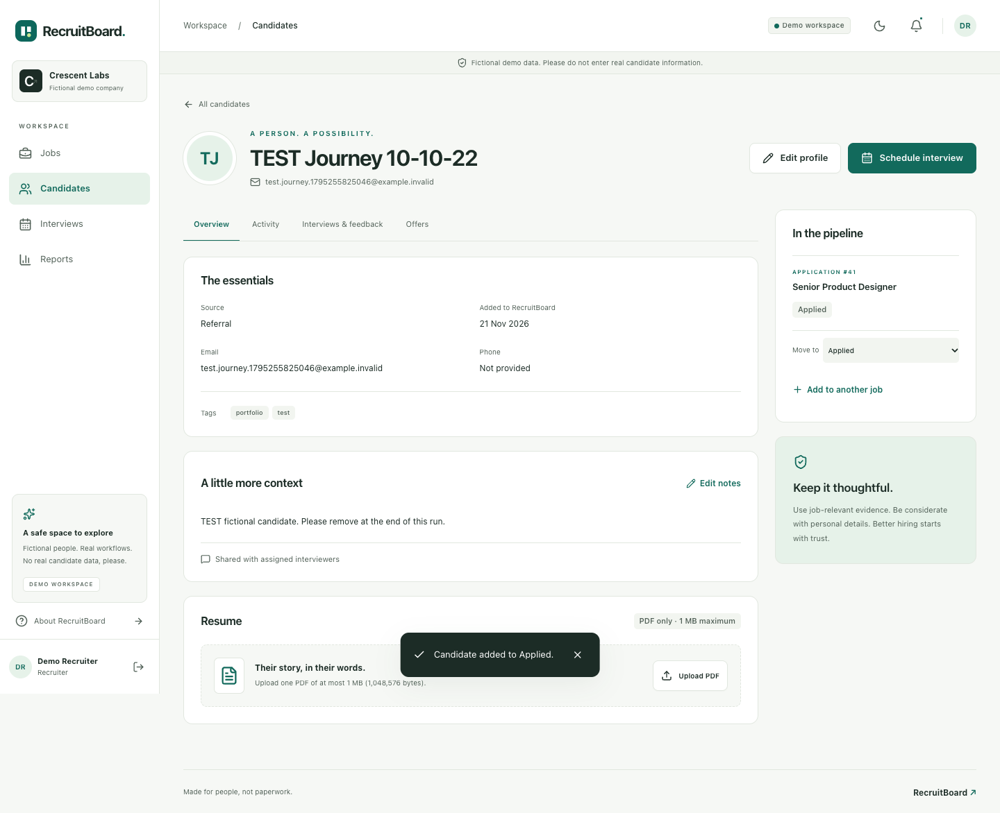
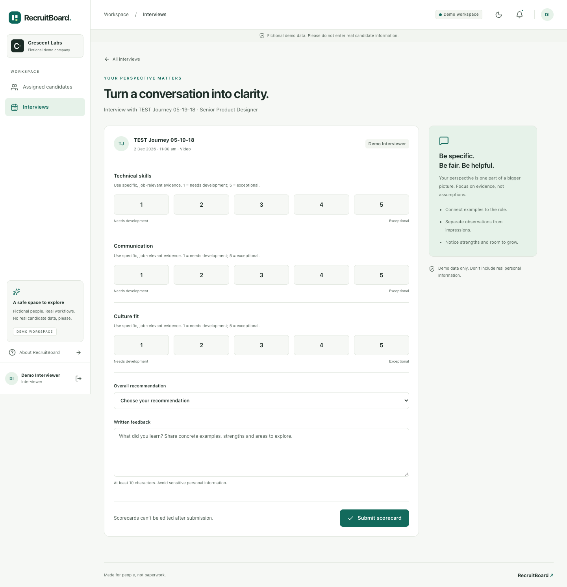
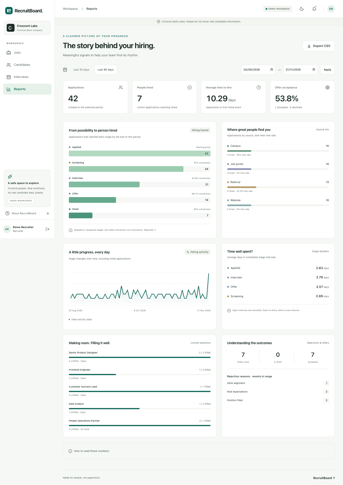
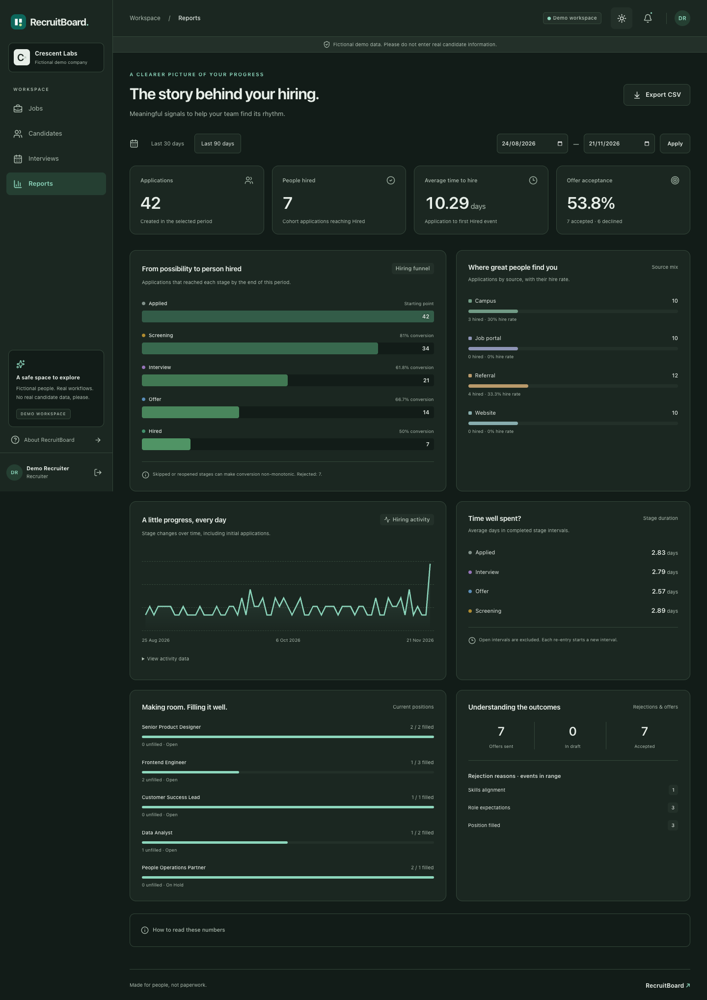
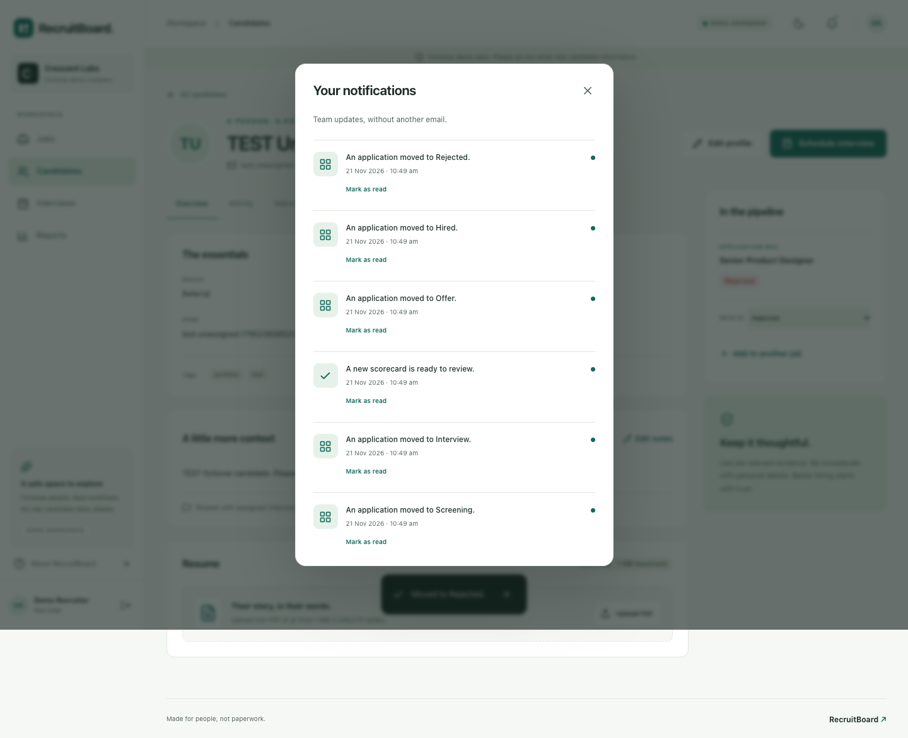
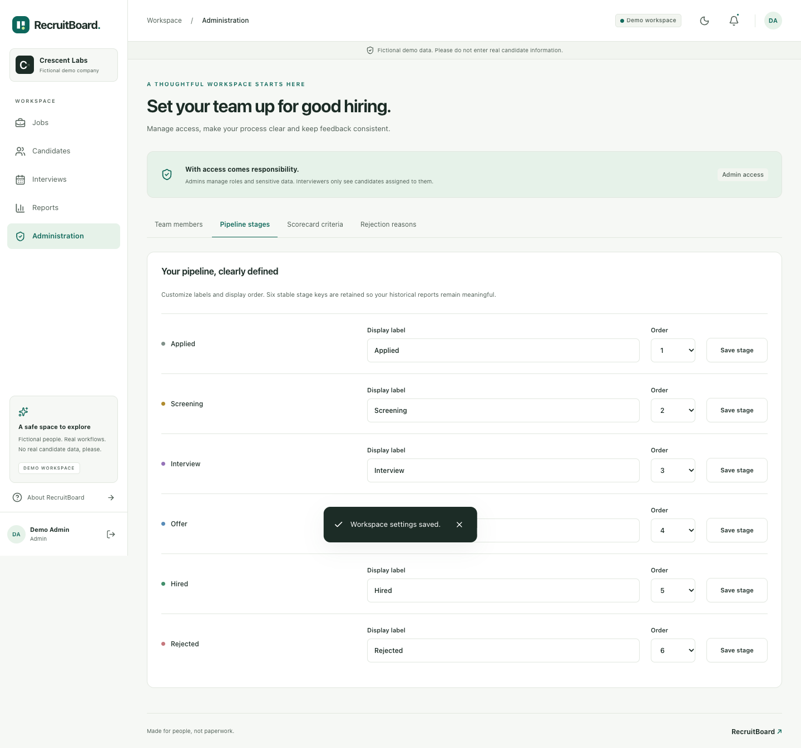
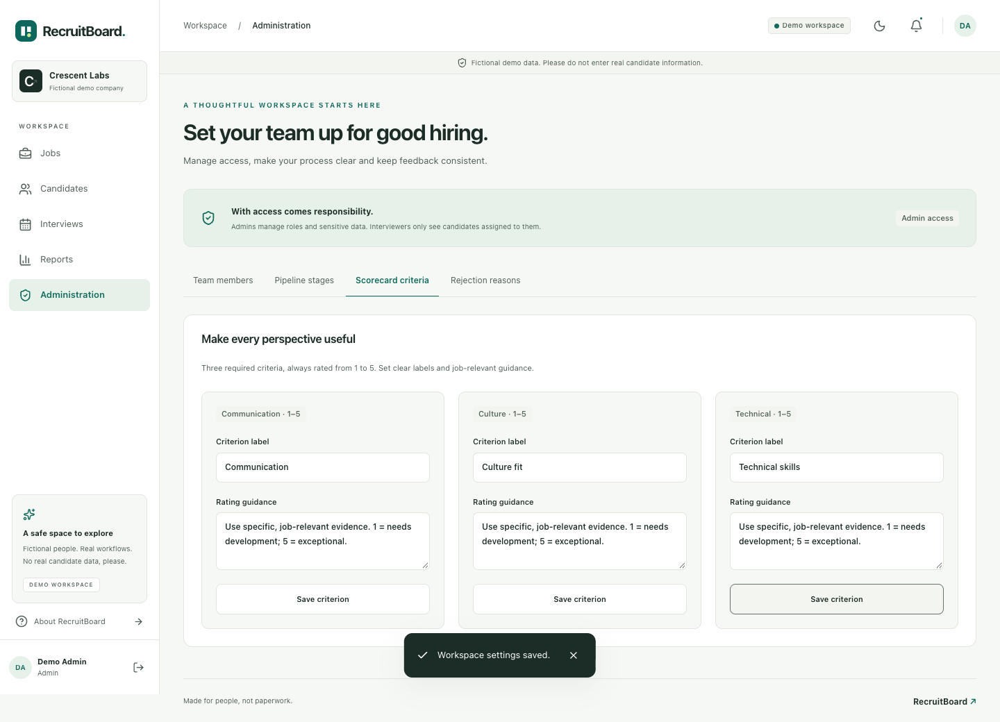
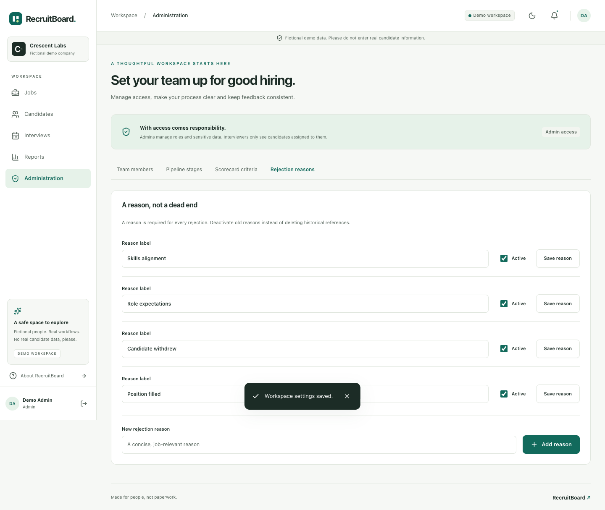
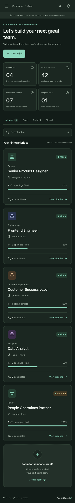
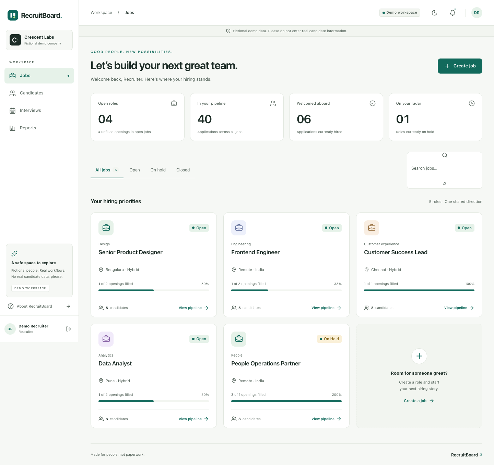

# RecruitBoard — delivery and verification report

**Report date:** 21 November 2026, Asia/Kolkata. **Current status: local implementation verified and public GitHub main published; Neon creation reported by the user; actual Render/Netlify deployment remains unverified.** A root Render Blueprint is prepared and locally validated for the user's dashboard deployment. This report distinguishes user-reported setup from independently verified results.

## 1. Project overview

RecruitBoard is an original hiring-pipeline product with its own geometric mark, calm teal visual identity and application code. It was created in the isolated `recruitboard` folder inside the existing workspace; no other project was edited. `ARCHITECTURE.md` was written before implementation and documents the repository, database, permissions, data flow and report definitions.

The repository contains two separate projects: a static Vite/React/TypeScript frontend and a Python/FastAPI backend using SQLAlchemy and Alembic. PostgreSQL on Neon is the intended production database; SQLite was used for local development and tests. Python is pinned to 3.11.15 and Node to 22.22.0. Automatic, serialized startup migrations and an explicitly enabled, empty-database-only seed are implemented. The seed creates the fictional company Crescent Labs, six demo identities, five jobs and forty fictional candidates with 90-day histories, interviews, scorecards, rejections and offers.

Completed locally: sign-in and three demo roles; jobs and job-specific kanban; native keyboard/touch Move to menus and drag-and-drop; required rejection reasons; candidate search, filters, sorting and pagination; profiles, notes, database-stored PDF resumes, timelines, interviews and scorecards; offers; notifications; hiring reports and injection-protected CSV; admin user/role/settings management and candidate anonymization/deletion. Server-side role and assignment rules protect reads as well as writes. Only the exact assigned interviewer can submit a scorecard; recruiters/admins cannot impersonate that person.

**Links and publication:** public repository [DIVYAPRIYADHARSHINI-GIT/recruitboard](https://github.com/DIVYAPRIYADHARSHINI-GIT/recruitboard), main initially published at `daac6e6`. Remote existence, public visibility and the pushed main commit were rechecked before the Blueprint update. Local preview is `http://127.0.0.1:4173` while the local servers run. The user reported creating Neon project `recruitboard`, Free, AWS Asia Pacific 1 (Singapore), production branch, and retains its connection string privately. There is still no confirmed real public frontend/backend URL. No hosting resource or database was created by the agent, no production database was connected locally, and no Vercel or payment details were used.

The same-origin `/api` proxy design was verified in local Chrome with the actual frontend and backend. Netlify's official documentation supports the external rewrite. Live Netlify cookie forwarding, PostgreSQL startup and cross-service behavior remain unverified until deployment. All private hosting values are reserved for the user to enter directly into dashboards.

## 2. Testing and evidence

### Latest completed suites

| Suite | Passed | Failed | What was actually checked |
|---|---:|---:|---|
| Backend API, SQL and security | 95 | 0 | Role matrix, assignment scope and revocation, CSRF, session expiry/rotation and flags, real-password login, stages/history/concurrency, duplicate email, filters, PDF bounds/type/header checks, scorecards, notifications, offers, privacy actions, SQL aggregates, CSV injection, migration/model parity |
| Frontend unit tests | 16 | 0 | Formatting, empty rates, file validation, same-origin credentials/CSRF and friendly API errors |
| Real local Google Chrome journeys | 66 | 0 | Recruiter → interviewer → recruiter → admin journey, real key events for a move, drag-and-drop, uploads/downloads, offer acceptance, report CSV, permissions, theme persistence, mobile navigation, cleanup and console checks |
| Deployment configuration | 8 | 0 | Reject unsafe proxy origins and produce API rewrite before SPA fallback; no network or hosting resource used |
| Render Blueprint configuration | 9 | 0 | One Free Singapore service, main/backend, pinned Python, exact commands/port/worker/health, auto-deploy on, complete actual config variables, dashboard-only values and official Render JSON-schema validation |
| TypeScript and production build | Passed | 0 | Strict TypeScript check and actual static production bundle |
| Python dependency advisory scan | No known findings | 0 open | Installed local environment after patched versions were installed |
| Complete npm dependency advisory scan | No known findings | 0 open | Runtime plus build/test dependencies after targeted upgrades |
| Live hosting suite | Not run | Not run | The real service URL is not verified; the one-live-suite quota has not been used |

The five counted functional/configuration suites contain **194 passing checks**; earlier-stage and repeated passes are not added again. The Blueprint task added nine offline checks, all passing in 0.58 seconds; the application/live suites were not rerun for a configuration-only change. The Chrome suite includes **18 axe WCAG A/AA audits**, each with zero violations, and matching layout checks. This is automated coverage, not a certification of all accessibility or all future data. Chrome reported version **157.0.8103.79**. Unexpected browser console/page errors were zero in the successful run.

The final patched frontend build passed with approximately 319.40 kB JavaScript (98.61 kB gzip) and 60.72 kB CSS (11.99 kB gzip). Backend tests retain two upstream deprecation warnings concerning Starlette's test-client compatibility with httpx/AnyIO. These warnings are not hidden and did not fail the tests.

### Historical failures and retries

The initial foundation run had one collection error. Its first retry had one passed test and nine fixture setup errors; the next run passed all ten foundation tests. The first business suite had 84 passes and one failure; after fixing transaction autoflush it passed all 85. Ten additional hardening tests brought the final backend total to 95, all passing.

Local Chrome attempts before the successful journey recorded **1 pass/1 failure**, **4 passes/1 failure**, **12 passes/1 failure**, and **34 passes/1 failure**, respectively. These were stopped at the first failing check rather than reporting later unexecuted checks as passes. All original diagnostic transcripts, axe JSON and failure screenshots are preserved in `bugs/`. Dependency audits also intentionally stopped publication until their reported findings were resolved. Detailed causes follow in section 3.

### Test-data cleanup

Browser-created records are visibly named **TEST Journey …** and **TEST Unassigned …**, with fictional `example.invalid` emails. The interrupted 34-pass run created two candidates and deleted both in its cleanup path. The successful 66-check run also created two and deleted both through admin privacy actions. The result JSON files list each created ID and `cleaned: true`. Backend tests use isolated ignored SQLite fixtures, not the demo database or production. No real personal data or production test data has been introduced. Built-in fictional demo identities and the forty seeded fictional candidates intentionally remain.

### Actual testing screenshots

All images below were captured by real installed Google Chrome against the local production build. They are not generated mockups. Some screenshots were taken before TEST cleanup, so their counts temporarily include the two clearly labelled test candidates.

*Home: original product identity, editorial introduction and illustrative pipeline.*

*Sign-in: password entry and three explicit demo-role choices, with the shared-demo warning.*

*Jobs: five fictional roles, current application counts, openings and status filters.*

*Kanban: canonical stage columns with counts and a keyboard/touch Move to control on every card.*

*Candidates: real server-backed listing, filters, sorting and pagination.*

*Profile: a clearly labelled TEST candidate, shared notes, application stage and the one-PDF/1-MB notice.*

*Scorecard: assigned interviewer ratings, recommendation and evidence-based feedback fields.*

*Interviews: interviewer-scoped conversations, local time display and feedback status.*

*Light reports: SQL-derived funnel, time to hire, sources, activity, positions, offers and rejection reasons.*

*Dark reports: separately themed surfaces and charts; theme survives reload.*

*Notifications: in-app scorecard, assignment and stage updates, without emails.*

*Administration: user identities, roles, active state and protected built-in demo accounts.*

*Administration: editable labels/order with stable reporting keys.*

*Administration: three required 1–5 criteria with editable guidance; the test restored its temporary guidance change.*

*Administration: active/deactivated reasons preserve historical references.*

*390-pixel mobile light view: single-column jobs, compact navigation and no document overflow.*

*390-pixel mobile dark view: theme and mobile navigation verified in the same browser.*

*Mobile kanban: intentionally horizontally scrollable board inside a non-overflowing page, with touch-accessible Move to controls.*

## 3. Bugs and issues

### Documentation-search contradiction — resolved, live runtime still pending

The first Netlify research summary incorrectly claimed Node 22 was unsupported. A follow-up against the primary build-dependency documentation confirmed Node 22 static builds are supported. The conflicting result and source URLs are retained in [BUG-001](bugs/BUG-001-documentation-conflict.md). This was a research-tool answer problem, not an observed Netlify deployment error; no deployment had occurred.

### Pydantic validator name collision — fixed

The first backend test collection failed because a helper named `email` was shadowed by the schema field of the same name. Renaming it `normalize_email` fixed collection. The actual [failed-run transcript](bugs/20261121-102728-390446-stage1-backend.txt) remains. No screenshot applies to a Python collection error.

### Missing test scratch-directory parent — fixed

The next run produced nine setup errors because the explicitly requested project-local pytest directory had no parent. Creating that parent fixed the harness. The [original diagnostic](bugs/20261121-102758-707581-stage1-backend-retry1.txt) is preserved. Tests never fell back to another project's directory.

### Duplicate scorecard autoflush — fixed

The duplicate-scorecard test exposed an ORM autoflush during recipient lookup, before the transaction conflict handler could return 409. Request sessions now use explicit transaction flush/commit boundaries, and the duplicate returns 409 without a second scorecard or notification. The [failed business suite](bugs/20261121-103000-207733-stage2-backend.txt) is retained. That diagnostic printed fictional TEST feedback as a SQL parameter; no real candidate or credential was involved. SQLAlchemy parameter hiding and sanitized exception handling were added to prevent such disclosure in subsequent failures.

### Landing-page decorative avatar contrast — fixed

The first Chrome accessibility audit found low contrast in the third small decorative avatar. Its text was darkened, and the home audit then passed. The original axe result and screenshot remain.

*Original failing home capture; the issue was the third tiny avatar's text, not the large hero heading.*

### Sign-in muted-text contrast — fixed

The next audit found insufficient contrast on the tinted sign-in panel. Darkening the shared light-theme muted token corrected those two text nodes and avoided repeating the problem on similar surfaces.

*Original failing sign-in capture; axe identified the aside paragraph and footer text.*

### Form accessible-name/locator mismatch — fixed

The browser found the candidate form, entered the name/email, then could not match the exact Job label because the implicit label included option text. Concise explicit accessible names were added to relevant compact controls, including Job, Source and Notes. The next journey successfully created candidates.

*Actual stopped test: the form was rendered, but the exact accessible-name locator failed before submission.*

### Vertically stacked search field — fixed

Designer image review caught a layout problem the overflow check did not detect: the shared label rule made the search icon, input and hint stack vertically. Explicit row direction fixed search, sort and compact Move to labels. This shows why actual screenshot review was useful in addition to automated checks.

*Original jobs capture with an unnecessarily tall, vertically stacked search control.*

### Invalid ARIA on unread notification markers — fixed

The journey reached 34 passing checks before axe rejected `aria-label` on a generic span. The unread visual marker now has an appropriate image role and accessible name. All 18 final page/modal audits passed after this correction.

*Original notification-panel capture; the semantic problem was identified by axe, not by a visible layout change.*

### Dependency findings and resolver retries — resolved at scan time

The initial frontend runtime audit reported two high-severity router findings. The router was upgraded to 7.18.6, and the runtime audit became clean. The Python environment audit found sixteen advisories across five packages, including development tooling. Targeted upgrades included FastAPI 0.165.0, Starlette 1.6.0, Uvicorn 0.54.0, python-multipart 0.0.31, pytest 9.0.3, and local pip/setuptools. The first upgrade attempt failed because the initially chosen Starlette patch was below FastAPI's required version; the compatible pin resolved it, and all backend tests still passed.

A later full npm audit also checked build/test dependencies, rather than only shipped runtime code. It found four affected dependency entries (one moderate, one high, two critical). Vite was patched to 7.3.8. The initially recommended Vitest 3.2.7 still left three transitive findings, so Node/Vite compatibility was checked and Vitest was updated to 5.1.1. The final complete npm scan reported zero vulnerabilities, and all sixteen unit tests plus the build passed. The failed audit/resolver transcripts are retained under their original filenames in `bugs/`; no `audit fix --force` was used.

### Audit invocation and package-output mistakes — corrected

An initial pip-audit command incorrectly used `--disable-pip` without requirements mode; the tool returned a usage error. Removing the incompatible flag fixed the invocation. A separate read-only package-version command used `head`, causing pip to emit BrokenPipeError when its output pipe closed early. [The labelled diagnostic](bugs/BUG-009-package-version-query-broken-pipe.md) preserves this mistake. These were builder command errors, not RecruitBoard or hosting failures.

### Hosting handoff and Blueprint verification diagnostics

One approved health request to a user-supplied Render hostname returned HTTP 404. The user subsequently clarified that the hostname contained a placeholder; the actual service URL remains unknown. The [original health diagnostic](bugs/20261121-113046-845408-render-health-initial.txt) is retained. This is not a failed PostgreSQL test or evidence that the actual Render service is unhealthy.

The Blueprint update explicitly configures one Free Singapore Python service, main/backend, the pinned Python version, one Uvicorn worker on Render's port, /health and automatic deployment on. No Render database or unused SESSION_SECRET variable is added; DATABASE_URL and ALLOWED_ORIGINS are supplied through initial dashboard prompts. Broad Blueprint research included non-primary sources and an overly broad existing-service claim, so the primary documents were fetched directly. The initial schema-fetch check also made a local assertion mistake about Render's allOf-based schema; its failure and correction are preserved in [BUG-012](bugs/BUG-012-blueprint-research-verification.md). These are research/checking issues, not fabricated deployment failures.

### Open warnings and external blockers

Two upstream Python test-client deprecation warnings remain. No application test failure is currently open. Live PostgreSQL compatibility and the three-host deployment have not been independently verified. No deployment screenshot was fabricated; the only external health diagnostic concerns the hostname later identified as a placeholder.

## 4. Advantages of Designer observed in this build

Designer allowed architecture, source, documentation and evidence to be maintained in one isolated folder. Version-checked edits made the affected paths explicit; no other project needed modification. Background shell tasks made dependency installation, backend tests and frontend work possible without blocking every step.

The image-view tool displayed the real browser screenshots for visual review. This helped catch the stacked search control even after automated layout checks passed. Shell-driven installed Chrome and axe could exercise actual cookies, keyboard input, drag-and-drop, downloads and all three server-backed roles rather than relying on static mockups.

The question tool provided separate, explicit permission checkpoints. Public hosting research and GitHub publication approval were recorded separately from unapproved database/hosting account access. Tool output and local evidence files made exact pass/fail counts and retained failure records available for this report.

## 5. Disadvantages and limits of Designer observed in this build

A web-search summary contradicted primary Netlify build documentation and needed follow-up. The tool's answer could not safely be treated as a verified runtime fact without checking the cited primary source. Some package-tool output was verbose and required careful reading; an attempt to truncate it with a pipe produced a real command error.

Browser testing required writing and running a Playwright harness through the installed Chrome executable. The workflow did not automatically provide all journeys, screenshots or accessibility coverage; those had to be implemented and maintained. Native select/label matching and framework transaction behavior required real tests to diagnose.

No observed Designer capability granted automatic access to Neon, Render or Netlify accounts, nor could it authorize spending or handle secret dashboard values on the user's behalf. Those are deliberate permission boundaries, not reasons to request internal API keys or a developer build. The code and CSS defects described above were builder implementation mistakes; they are not presented as Designer application crashes.

## 6. Scope for future Designer improvements

A first-class web-testing panel could integrate local servers, browser journeys, screenshots, console events and axe results into one permission-aware view. It would reduce the amount of custom harness code while preserving real evidence and exact counts.

An automatic immutable failure ledger, with redaction before persistence, could link each failed command/test to its later fix without manual cross-referencing. Source-linked dependency audits and clearer primary-source provenance would help avoid obsolete package pins and conflicting hosting summaries.

Secret-blind deployment handoffs could show a user the exact dashboard fields to fill, confirm only readiness/status, and keep credentials entirely outside the agent transcript and local workspace. A free-tier quota preview before any deploy would further protect users from accidental usage.

## 7. Unverified work and RecruitBoard limits

There are no confirmed live URLs yet. Neon PostgreSQL, Render startup migrations/advisory locking, exact cloud runtime availability, Netlify Set-Cookie forwarding, actual production CORS/proxy behavior, production rate-limit client-IP handling and free-account remaining quotas remain unverified. Local SQLite and local proxy success are not represented as production verification. The one permitted full live suite has not run.

Free Render services sleep after fifteen minutes of inactivity and may need about a minute to wake. Netlify's proxy timeout can expire before that wake completes, requiring a user retry. Neon also scales compute to zero. No load tests, continuous keep-alive pings, paid upgrade or SLA are part of this project. Current official free-plan research and exact deployment steps are in `DEPLOY.md` and `evidence/HOSTING_RESEARCH.md`.

RecruitBoard uses single-worker, in-memory rate counters that reset on restart, not a distributed anti-abuse service. It has no MFA, SSO, password-reset emails, background email jobs or malware scanner. PDF MIME/extension/signature checks do not prove a document is harmless. Passwords are Argon2id-hashed; field-level candidate encryption and compliance certification are not claimed. The shared demo intentionally lets strangers act as demo admins, so it must never hold real candidate data.

The board caps rendered cards at 500 while retaining real column counts; the paginated candidate list remains the way to find all records. Activity timelines show the latest 200 generic events, notifications the latest 100, and user administration up to 500 accounts. Interview filters apply to the current 30-item page. Six stable stages and three required criteria can be relabelled/configured, not arbitrarily added or removed. Openings can be overfilled; the system reports that state rather than silently changing the hiring history.

Reports have documented cohort/event/snapshot distinctions. Source counts are application counts, open intervals are excluded from dwell averages, and skipped/reopened stages may give non-monotonic conversions. No business or legal conclusion should be inferred from the fictional seed data. Production backups, disaster recovery, long-running concurrency and assistive-technology manual testing remain unverified.

**Summary:** the local product, architecture, documentation, tests, real screenshots and retained bug evidence are complete. Publication and hosting are separate permission-gated steps; no live success is claimed until it is observed.
